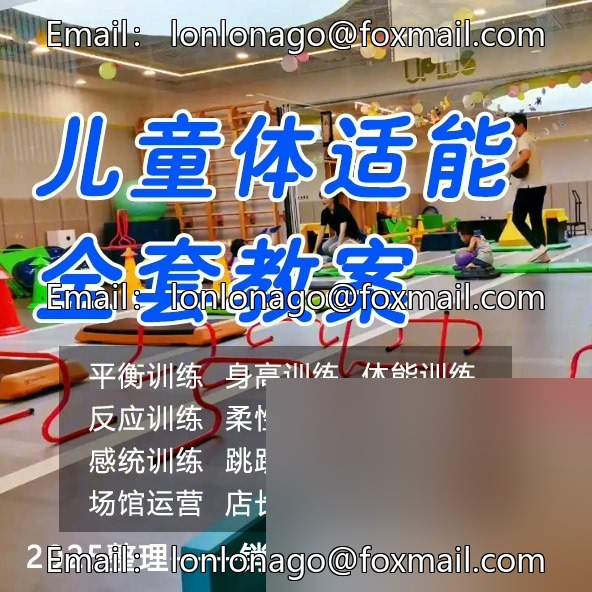
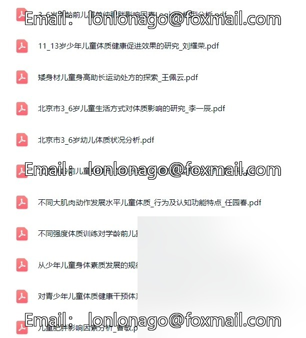

# Kids physical fitness lesson courses, youth physical fitness balance and sensory training, kindergarten sports fitness hall

## Body

Child fitness instruction course, adolescent physical fitness balance and sensory training, kindergarten sports teaching presentation video, PPT, word, pdf document materials, rich and comprehensive, suitable for venue training and operation, parents and children's self-learning. Includes teaching videos of basketball, martial arts, balance bike, physical fitness training, etc.

Balancing training  Height training  Physical fitness training  
Reaction training  Flexibility training  Coordination training  
Sensory-organization training  Jumping training  Core training  
Camp facility operation  Store manager handbook  Assessment table

online trading, and direct ordering allows immediate shipping.
I am online at long-term and will ship immediately.

The course covers children's fitness lesson plans, adolescent balance and sensory training, and kindergarten sports teaching materials, including PPT, word and pdf documents, along with basketball, martial arts, balance bike and physical training instructional videos.

<!-- AI_ENRICHED -->

## Images

## Payment

Here is a pay link on Stripe ( https://buy.stripe.com/3cs8yP7sY87d0vu9AB ). Please contact me lonlonago@foxmail.com after funding $89, and I will send you a complete data files , thank you!

